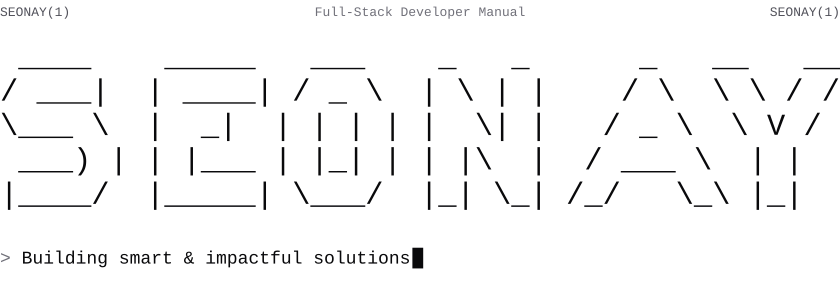
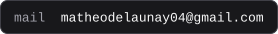
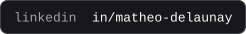
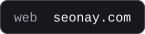
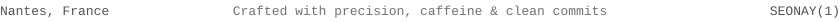

<!--
  SEONAY(1): a profile written as a manual page.
  Artwork lives in ./assets as dark/light pairs; regenerate with `python3 tools/build-assets.py`.
  GitHub can't theme-swap an image inside our own <a> (a <picture> ignores its <source> once an
  <a> sits between it and the ), so themed images stay unlinked and the link pills are a
  single filled variant that reads on both themes.
-->

<picture>
  <source media="(prefers-color-scheme: dark)" srcset="./assets/hero-dark.svg">
  
</picture>

<a href="mailto:matheodelaunay04@gmail.com"></a>&nbsp;<a href="https://www.linkedin.com/in/matheo-delaunay/"></a>&nbsp;<a href="https://www.matheodelaunay.studio/"></a>

<br>

### NAME

**seonay** — full-stack developer building fast, useful products for the web, from Nantes, France.

### SYNOPSIS

```sh
seonay [--freelance | --full-time] [--long-term] <your-idea>
```

### DESCRIPTION

```ts
const seonay: Developer = {
  name: "Mathéo 'Seonay' Delaunay",
  role: "Full Stack Developer",
  location: "Nantes, France",
  focus: ["Clean architecture", "Impactful UX", "Performance"],
  currently: "Cooking secret side projects",
  openTo: ["Freelance", "Full-time", "Long-term"],
};
```

### OPTIONS

<table>
  <tr>
    <td width="180"><code>--frontend</code></td>
    <td>React, Next.js, TypeScript, Tailwind CSS, Framer Motion</td>
  </tr>
  <tr>
    <td><code>--backend</code></td>
    <td>Node.js, Rust</td>
  </tr>
  <tr>
    <td><code>--infra</code></td>
    <td>Kubernetes, Git</td>
  </tr>
  <tr>
    <td><code>--design</code></td>
    <td>Figma</td>
  </tr>
</table>

### EXAMPLES

<table>
  <tr>
    <td valign="top" width="180">
      <a href="https://www.seonay.com/"><b>Portfolio</b></a><br>
      <sub>seonay.com</sub>
    </td>
    <td valign="top">
      Personal portfolio showcasing projects, design concepts and experiments.<br>
      <sub>React, Tailwind CSS, Framer Motion</sub>
    </td>
  </tr>
  <tr>
    <td valign="top">
      <a href="https://life.seonay.eu/"><b>CoreHub</b></a><br>
      <sub>Early access</sub>
    </td>
    <td valign="top">
      One hub for everything: habits, sport, expenses, freelance work, reading and more.<br>
      <sub>Next.js, Rust, Kubernetes</sub>
    </td>
  </tr>
  <tr>
    <td valign="top">
      <a href="https://www.abecedate.app/"><b>Abécédate</b></a><br>
      <sub>Waitlist open</sub>
    </td>
    <td valign="top">
      A couples app: 26 dates from A to Z, a shared polaroid journal and home-screen widgets for two.<br>
      <sub>React Native (Expo), Supabase, SwiftUI, Kotlin</sub>
    </td>
  </tr>
  <tr>
    <td valign="top">
      <b>Classified</b><br>
      <sub>Coming soon</sub>
    </td>
    <td valign="top">
      Secret side projects. Stay tuned for upcoming releases.
    </td>
  </tr>
</table>

### DIAGNOSTICS

<picture>
  <source media="(prefers-color-scheme: dark)" srcset="https://github-readme-stat.seonay.com/api?username=D-Seonay&amp;show_icons=true&amp;hide_border=true&amp;include_all_commits=true&amp;count_private=true&amp;custom_title=GitHub%20stats&amp;bg_color=00000000&amp;title_color=fafafa&amp;text_color=a1a1aa&amp;icon_color=fafafa&amp;ring_color=fafafa">
  
</picture>
<picture>
  <source media="(prefers-color-scheme: dark)" srcset="https://github-readme-stat.seonay.com/api/top-langs/?username=D-Seonay&amp;layout=compact&amp;hide_border=true&amp;langs_count=6&amp;card_width=320&amp;custom_title=Most%20used%20languages&amp;bg_color=00000000&amp;title_color=fafafa&amp;text_color=a1a1aa">
  
</picture>

<picture>
  <source media="(prefers-color-scheme: dark)" srcset="https://streak-stats.demolab.com/?user=D-Seonay&amp;hide_border=true&amp;background=00000000&amp;stroke=3f3f46&amp;ring=fafafa&amp;fire=fafafa&amp;currStreakNum=fafafa&amp;currStreakLabel=fafafa&amp;sideNums=fafafa&amp;sideLabels=a1a1aa&amp;dates=71717a">
  
</picture>

### AUTHOR

Written by Mathéo “Seonay” Delaunay. Got a project in mind? Write to [matheodelaunay04@gmail.com](mailto:matheodelaunay04@gmail.com).

<br>

<picture>
  <source media="(prefers-color-scheme: dark)" srcset="./assets/footer-dark.svg">
  
</picture>


